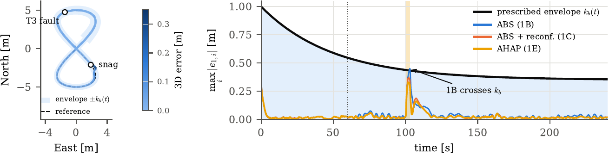
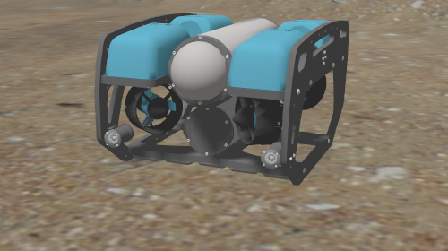
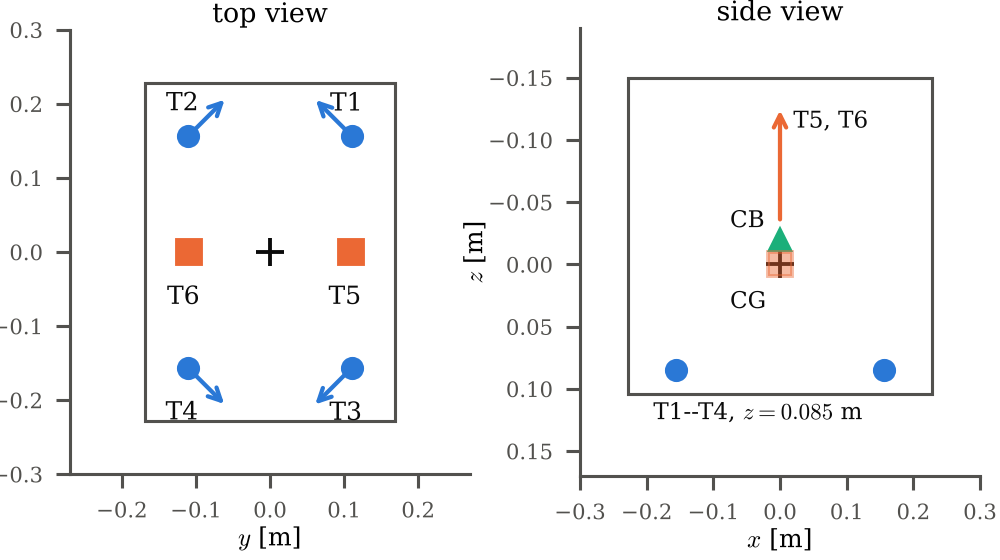
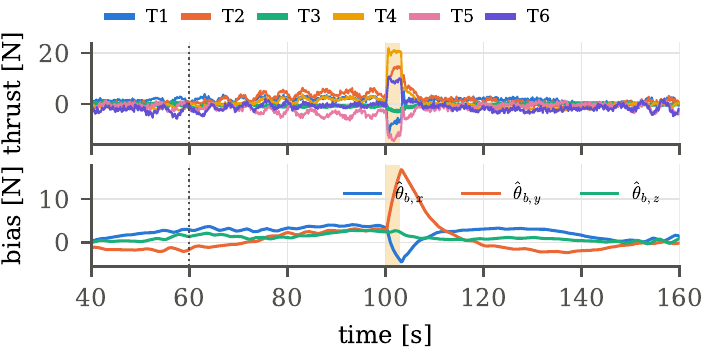

# AHAP: Adaptive Health-Aware Prescribed-Performance Control of an Unmanned Underwater Vehicle

Simulation video and supporting material for the paper

> B. L. Janka, D. Danacı and K. Cetin, *Adaptive Health-Aware Prescribed-Performance Control of an Unmanned Underwater Vehicle*, submitted to the European Control Conference (ECC 2027).

Izmir Katip Celebi University, Department of Electrical and Electronics Engineering.

## Video: case 1E (thruster fault and tether snag)

VIDEO-PLAYER-LINK

<!-- To make the video play here: open this README in the GitHub web editor, delete the line
     VIDEO-PLAYER-LINK above and drag media/case1E_ahap.mp4 into its place. GitHub uploads it
     (8 MB, under its 10 MB limit) and inserts a playable link. -->

Download: [media/case1E_ahap.mp4](media/case1E_ahap.mp4) (3 min 21 s, real time).

The video shows the controller running as a ROS 2 Humble node with Gazebo: the vehicle in the Gazebo scene (top left), its front and down cameras (top right), and the live dashboard (bottom) with the path, the tracking errors inside the envelope ±k_b, the thruster forces with the declared health, depth, roll and pitch, and the four sonar ranges. In this run the largest error reached 79.9% of the envelope (minimum margin 0.087 m, no violation), roll stayed below 1.6° and depth within 46 mm; the telemetry and report are in `data/case_1E_gazebo/`.

The six-thruster BlueROV2 follows a figure-eight at 8 m depth (5 m amplitude, 0.30 m/s peak speed) for 240 s in a 0.10 m/s current, with waves and a 35 m tether. Two events are applied:

| Time | Event |
| --- | --- |
| 60 s | Thruster T3 drops to 10% effectiveness |
| 63 s | The fault is reported to the controller, which redistributes thrust |
| 100–103 s | A 30 N sideways tether snag |

AHAP keeps the position error inside the prescribed envelope throughout: the largest error reaches 78–82% of the envelope (5 noise realisations), against 88–93% for an equally informed adaptive-backstepping baseline.



## The controller

AHAP controls five degrees of freedom of the six-thruster BlueROV2 (x, y, z, roll, yaw); pitch has no independent thrust and is left passive, with a speed condition that keeps it bounded. It combines five elements:

1. **Prescribed envelope:** a time-varying barrier Lyapunov function keeps each error inside an envelope that shrinks from 1 m to 0.35 m.
2. **Dynamic surface control:** a first-order filter gives the derivative of the velocity command without differentiation.
3. **Adaptive regressor:** only gravity and buoyancy are compensated; the linear drag, quadratic drag and bias of each axis are learned online (15 parameters, projection and σ-modification).
4. **Health-aware allocation:** a redistributed pseudo-inverse weighted by the reported thruster health shifts thrust away from a degraded thruster.
5. **Pseudo-control hedging:** the part of the command the thrusters cannot deliver slows the reference instead of winding up the adaptation.

| Vehicle | Thruster layout |
| --- | --- |
|  |  |



## Data

`data/case_1E/` holds the telemetry of case 1E for the 5 noise realisations used in the paper (`telemetry_log_Case_1E_AHAP_Fault_Snag__s1.csv` … `__s5.csv`, 10 Hz). Main columns:

| Columns | Content |
| --- | --- |
| `elapsed_time` | time [s] |
| `x y z roll pitch yaw` | true pose (NED, m and rad) |
| `est_x est_y est_z est_yaw` | navigation estimate seen by the controller |
| `target_x … target_yaw` | reference |
| `e1_*`, `e2_*` | position and velocity errors (surge, sway, heave, yaw) |
| `k_b_*` | prescribed envelope |
| `thrust1_n … thrust6_n` | commanded thruster forces [N] |
| `theta_*` | adaptive estimates (linear, quadratic, constant per axis) |
| `anti_windup_norm` | norm of the hedge state |
| `true_health_min`, `eff_loss` | thruster health |

`data/prove_t3_share.py` reproduces one statement of the paper from these logs as an example:

```bash
python3 data/prove_t3_share.py data/case_1E
```

## Simulation setup

- Truth plant: 6-DOF BlueROV2 model at 1 kHz with T200 thruster dynamics, a Gauss–Markov current, irregular waves (0.5 m significant height), a 35 m lumped-mass tether and a battery model.
- Navigation: the controller (100 Hz) sees only a fused estimate from a DVL, an attitude sensor, a depth sensor and delayed short-baseline positioning.
- The same controller runs as a ROS 2 Humble node with Gazebo for visualisation.

## Contact

Kamil Cetin (corresponding author): kamil.cetin@ikc.edu.tr

## Acknowledgement

Supported by the Izmir Katip Celebi University Scientific Research Projects Coordination Unit (project 2026-TYL-FEBE-0000).
